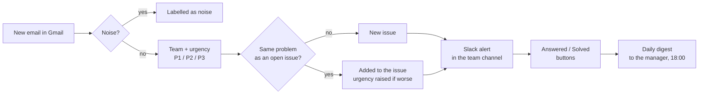
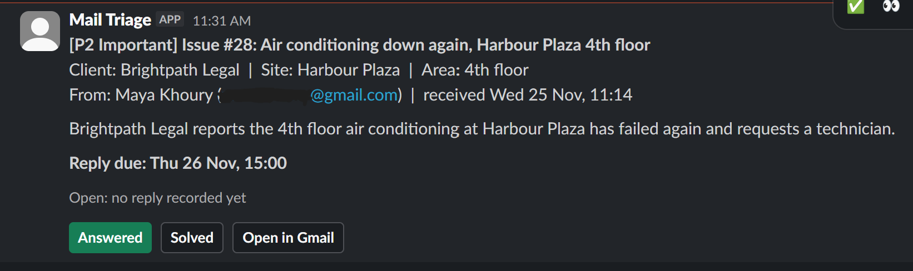
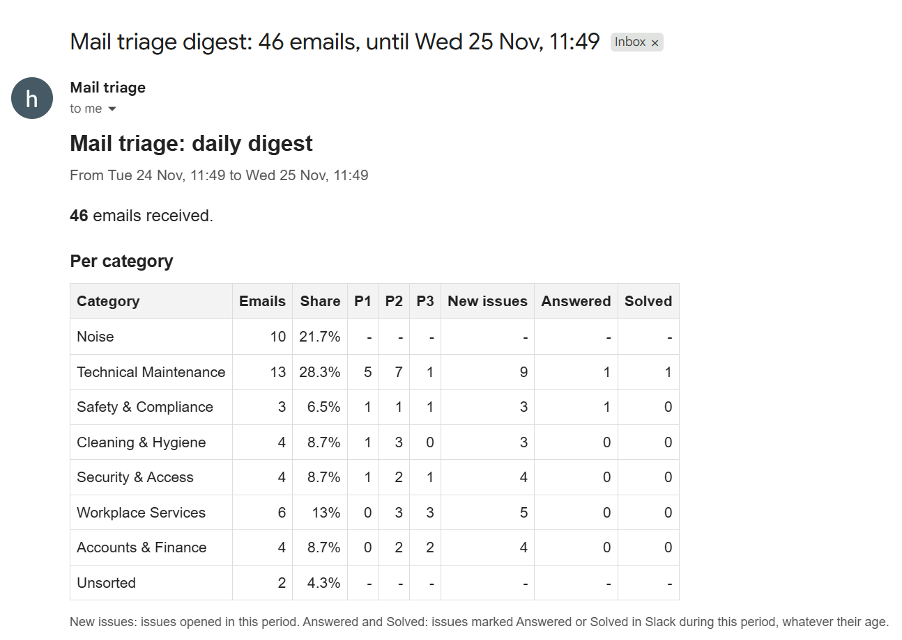
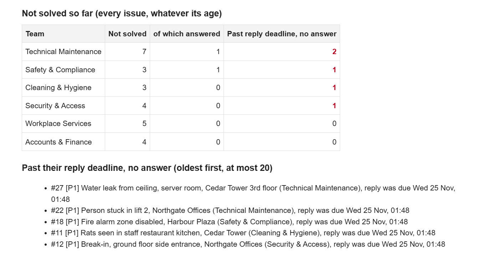
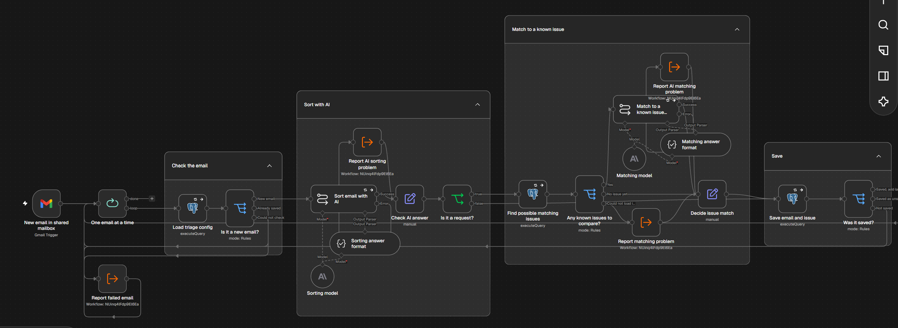
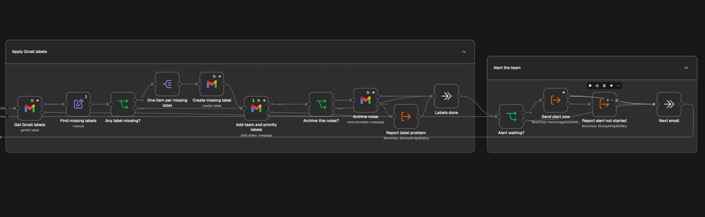

# Facility Management email triage

An automation that reads a facility management company's shared mailbox, sends every real request to the right team with an urgency and a deadline, groups emails about the same problem, alerts the team in Slack and sends the manager a daily summary.

Case study built for a fictional company ("Company A"), live since November 2026 and tested with 44 realistic emails. Built with **n8n**, **Supabase**, **Gmail**, **Slack** and an **AI model**.

---

## The problem

About 300 emails a day arrive in one shared mailbox. A flooded server room sits between a newsletter, a sales pitch and an invoice question. Someone has to read everything, decide who handles it and forward it. Urgent emails get buried, the same problem is reported three times and handled three times, and the manager has no clear view of what is late.

## What it does

Within a minute of arriving, every email is:
1. **Filed as noise** if it needs no action (newsletters, spam, out-of-office replies, sales pitches...).
2. **Sent to one of 6 teams** (Technical Maintenance, Safety & Compliance, Cleaning & Hygiene, Security & Access, Workplace Services, Accounts & Finance).
3. **Given an urgency and a reply deadline**: P1 Emergency (2 hours, day or night), P2 Important (1 working day), P3 Can wait (3 working days).
4. **Grouped with emails about the same problem** into one issue, matched on client, site and problem.
5. **Alerted in the team's Slack channel**, with buttons to mark the issue Answered or Solved.

Every evening the manager receives a digest: emails per team, urgencies, new issues, what was answered and solved, and every issue past its deadline.

### Example from the tests

"Air conditioning not working on the 4th floor" arrived as P2. Two hours later the client wrote that the AC was down on every floor and the server room was at 35 degrees. The system linked it to the same issue, raised it to P1 and alerted the maintenance team in the same Slack thread, with a new 2-hour deadline.

## Screenshots

**A Slack alert in the team's channel**, with the Answered, Solved and Open in Gmail buttons:

**The manager's daily digest** (from the test run): emails, urgencies, new, answered and solved issues per team, then everything still open and what is past its deadline:

**The main n8n workflow**, "Sort incoming emails": check the email, sort it with AI, match it to a known issue, save, apply Gmail labels, alert the team. Every failure exit (in orange) goes to a shared "Report a failure" workflow:

## Built for the real world

- **Nothing urgent is held back, nobody is woken up for nothing.** P1 alerts go out at once; P2 and P3 wait for working hours.
- **No email is ever lost.** If the AI fails, the email goes to the manager as "unsorted". If Slack fails, the alert is retried every 5 minutes. If the server is off, emails are picked up when it comes back.
- **No duplicates.** The same email is never processed twice; one problem gives one alert.
- **Secure buttons.** Every Slack click is checked; fake requests are refused.
- **Monitored.** Failures, crashes and unusual numbers of unsorted emails send a phone alert to the person who runs the system, at most once per 15 minutes.
- **Privacy.** The system's copy of email texts is emptied after 90 days; the statistics are kept.
- **Settings, not code.** Teams, urgency rules, working hours, labels, channels and AI instructions live in the database.

## How it is built

- 7 n8n workflows: sort incoming emails, send alerts, Slack buttons, daily digest, weekly cleanup, report a failure, health check.
- A Supabase (Postgres) database holding emails, issues, the full history of each issue, alerts and settings. Saving an email and its issue happens in one all-or-nothing step.
- Two AI steps: one sorts the email, one compares it with the known issues.

The source files are kept in a private repository.

## Contact

Henry Nasr, automation builder: [linkedin.com/in/henry-nasr](https://www.linkedin.com/in/henry-nasr)
